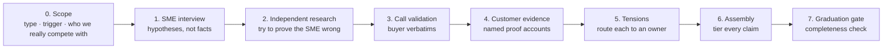

# Campaign Brief Builder: briefs that are true, not just convincing

> **Outcome:** every claim in a campaign brief carries an evidence tier, a named source and a cold-copy yes/no. A founder's brain dump can't quietly turn into confident ad copy.

A [Claude skill](https://docs.claude.com/en/docs/agents-and-tools/agent-skills/overview) that guides a marketer through building a B2B demand-gen brief **over several days, not in one prompt.** It's deliberately slow: SME interviews, desk research, call validation and customer proof all happen between sessions, and the skill enforces the evidence standards.

---

## The problem

Most campaign briefs start with an expert's brain dump and end as polished copy. Somewhere in between, *"I'm pretty sure buyers hate X"* becomes *"Buyers hate X"* in a cold email, and nobody decided that on purpose. An AI that drafts a full brief in four minutes makes this worse: it sounds right and is often wrong.

## How it works

The stages can be done in any order, but **completeness is checked before a brief graduates** from Hypothesis.

## The evidence tiers

| Tier | Means | Cold copy? |
|---|---|---|
| **Proven** | A customer outcome after the sale | Eligible |
| **Validated** | Confirmed by independent sources | Eligible (still gated) |
| **SME-asserted** | An expert described it specifically, but nothing is written down | **Never.** A rep can say it in conversation, with a named owner to confirm it |
| **Hypothesis** | One data point, or an untested assumption | Never |

*SME-asserted* is the tier I'm proudest of. Founder and product sessions constantly produce claims that are stronger than a guess but weaker than proof. Without a tier for them, they either get buried or quietly promoted into copy.

## Rules it enforces

- **Challenge every SME input.** After any expert input, the next move is "here's what I'd check to see if this is wrong." The most valuable findings are corrections.
- **Pause for real-world input.** The skill hands over an interview guide or call worksheet and *waits*. It never simulates research or invents call findings.
- **Separate proof of pain from proof of outcome.** Records show why customers moved, rarely what improved afterwards. An account is never attached to an ROI claim its records don't support.
- **Hold tensions open, visibly.** Conflicts between the SME, research, calls and product get routed to the right person instead of the AI quietly picking a side.
- **The brief carries its own state.** Its Confidence level, changelog and open ask-list *are* the progress tracker, so any session can pick up where the last one left off.

## Retro mode: the process improves without drifting

A separate, opt-in mode for improving *the process itself*. Friction gets logged one line at a time during normal work. In a retro, each item is judged **one-off vs. systemic**, specific changes are proposed with evidence, a human approves them, and the template gets a new version. **The system never edits itself silently.**

## What's in the repo

| Path | What it is |
|---|---|
| `SKILL.md` | Run mode, retro mode, enforcement rules, completeness check |
| `references/stages.md` | Method and exit criteria for each stage |
| `references/research.md` | The independent research playbook: challenge patterns and tiering |
| `references/call-worksheet.md` | How to build a call-validation search worksheet |
| `references/customer-evidence.md` | Mining customer records for proof accounts |
| `references/tensions.md` | Surfacing, sorting and routing conflicts |
| `references/retro-mode.md` | The process-improvement protocol |
| `templates/brief-template.md` | The brief's section structure |
| `config.md` | Where your briefs, customer records and calls live |

## Use it

Add it to your Claude skills, fill in `config.md`, and say *"Start a campaign brief for <segment>."* Then plan to come back to it over a few days, because that's the point.

---

*A demand-gen companion to my [event ops toolkit](https://github.com/parker-lauren). All examples are generic.*
